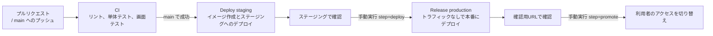

# 営業日報システム CI/CD 設定手順書

> 更新日: 2026-11-13 / 状態: 初版(プロジェクトの作成、Neon、承認者、認証の確認を追加)
> 構成は [tech-stack.md](tech-stack.md) を参照。

## 1. 全体の流れ



| ワークフロー | ファイル | 実行のきっかけ | 内容 |
| --- | --- | --- | --- |
| CI | `.github/workflows/ci.yml` | プルリクエスト、main へのプッシュ | `pnpm check`、`pnpm typecheck`、`pnpm test:coverage`(データベースを使うAPIテストを含む)、マイグレーションの確認、`pnpm test:e2e`(API、画面、データベースを起動して実行) |
| Deploy staging | `.github/workflows/deploy.yml` | main の CI が成功したとき | Docker イメージを作って Artifact Registry に保存し、ステージングにデプロイする |
| Release production | `.github/workflows/release.yml` | 手動実行(Actions 画面の「Run workflow」)と承認 | `step=deploy` でトラフィックなしで本番にデプロイし、`step=promote` で切り替える |
| Check Google Cloud access | `.github/workflows/gcp-auth-check.yml` | 手動実行 | Workload Identity 連携で認証できるか、デプロイに使う権限があるかを、読み取りだけで確かめる(3.4) |

- 本番へのデプロイは手動実行とし、さらに `production` の Environment の承認者(Required reviewers)が承認してから動くようにする。リポジトリは公開のため、GitHub の無料プランでも承認者を設定できる。誤った実行や、ステージングで確認していないバージョンの公開を防ぐため
- `Dockerfile` がまだないため、Deploy staging はスキップされる。アプリを作成して `Dockerfile` を追加すると動き出す
- Google Cloud への認証は Workload Identity 連携を使い、サービスアカウントのキーは発行しない

## 2. Google Cloud の初期設定

以下のコマンドは一度だけ実行する。`PROJECT_ID`、`PROJECT_NUMBER`、`OWNER`(GitHub のユーザー名か組織名。このリポジトリは `sakaishizue`)は実際の値に置き換える。

- コマンドは、手元の PC に [Google Cloud CLI](https://cloud.google.com/sdk/docs/install)(`gcloud`)を入れて実行するか、Google Cloud のコンソールの Cloud Shell で実行する
- 設定は、プロジェクトのオーナーの Google アカウントで行う(`gcloud auth login`)

### 2.1 プロジェクトの作成と API の有効化

Cloud Run などを使うには、プロジェクトに請求先アカウントを紐づける必要がある(無料枠の範囲でも必要)。プロジェクトIDは世界で一意のため、`nippo-` の後に組織名などを付ける。

```bash
gcloud projects create PROJECT_ID --name=nippo
gcloud billing accounts list
gcloud billing projects link PROJECT_ID --billing-account=BILLING_ACCOUNT_ID
gcloud projects describe PROJECT_ID --format="value(projectNumber)"
```

- 最後のコマンドで表示される番号が `PROJECT_NUMBER`。3.1 のリポジトリの変数にも使う

```bash
gcloud config set project PROJECT_ID
gcloud services enable run.googleapis.com artifactregistry.googleapis.com iamcredentials.googleapis.com secretmanager.googleapis.com
```

### 2.2 イメージの保管場所

```bash
gcloud artifacts repositories create nippo --repository-format=docker --location=asia-southeast1
```

### 2.3 サービスアカウント

| サービスアカウント | 用途 | 付与するロール |
| --- | --- | --- |
| `github-deployer` | GitHub Actions がデプロイに使う | Cloud Run 管理者、Artifact Registry 書き込み、`nippo-runtime` のサービスアカウントユーザー |
| `nippo-runtime` | Cloud Run のアプリが動作に使う | Secret Manager のシークレットへのアクセス |

```bash
gcloud iam service-accounts create github-deployer
gcloud iam service-accounts create nippo-runtime

gcloud projects add-iam-policy-binding PROJECT_ID --member="serviceAccount:github-deployer@PROJECT_ID.iam.gserviceaccount.com" --role="roles/run.admin"
gcloud projects add-iam-policy-binding PROJECT_ID --member="serviceAccount:github-deployer@PROJECT_ID.iam.gserviceaccount.com" --role="roles/artifactregistry.writer"
gcloud iam service-accounts add-iam-policy-binding nippo-runtime@PROJECT_ID.iam.gserviceaccount.com --member="serviceAccount:github-deployer@PROJECT_ID.iam.gserviceaccount.com" --role="roles/iam.serviceAccountUser"
```

### 2.4 Workload Identity 連携

GitHub の指定したリポジトリからだけ、`github-deployer` を使えるようにする。

```bash
gcloud iam workload-identity-pools create github --location=global

gcloud iam workload-identity-pools providers create-oidc github-actions --location=global --workload-identity-pool=github --issuer-uri="https://token.actions.githubusercontent.com" --attribute-mapping="google.subject=assertion.sub,attribute.repository=assertion.repository" --attribute-condition="assertion.repository=='OWNER/nippo'"

gcloud iam service-accounts add-iam-policy-binding github-deployer@PROJECT_ID.iam.gserviceaccount.com --role="roles/iam.workloadIdentityUser" --member="principalSet://iam.googleapis.com/projects/PROJECT_NUMBER/locations/global/workloadIdentityPools/github/attribute.repository/OWNER/nippo"
```

### 2.5 データベース(Neon)と接続文字列

[Neon のコンソール](https://console.neon.tech)で、本番用とステージング用の2つのプロジェクトを作る(技術選定書 3.4、3.7)。

| 項目 | 本番用 | ステージング用 |
| --- | --- | --- |
| プロジェクト名 | `nippo` | `nippo-staging` |
| リージョン | AWS Asia Pacific(Singapore) | AWS Asia Pacific(Singapore) |
| Postgres のバージョン | 最新 | 本番と同じ |
| 計算サイズ | 最小 0.25CU、最大 0.25CU(固定) | 本番と同じ |
| 自動停止(Scale to zero) | 有効(既定のまま) | 有効(既定のまま) |

- データベース名は既定の `neondb` のままでよい
- 「Connect」で表示される接続文字列のうち、アプリには接続プール用(ホスト名に `-pooler` が付くもの)を使う。マイグレーションには直接接続の接続文字列を使う(ステージングと本番へのマイグレーションの手順は、`Dockerfile` を作るときに5章に追加する)
- 接続文字列にはパスワードが含まれるため、ファイルやチャットに貼らない。次の Secret Manager への登録で、画面に直接貼り付ける

本番用とステージング用の接続文字列(接続プール用)を、Secret Manager に登録する。

| シークレット名 | 内容 |
| --- | --- |
| `nippo-database-url` | 本番用プロジェクトの接続文字列 |
| `nippo-staging-database-url` | ステージング用プロジェクトの接続文字列 |

```bash
gcloud secrets create nippo-database-url --data-file=-
gcloud secrets create nippo-staging-database-url --data-file=-

gcloud secrets add-iam-policy-binding nippo-database-url --member="serviceAccount:nippo-runtime@PROJECT_ID.iam.gserviceaccount.com" --role="roles/secretmanager.secretAccessor"
gcloud secrets add-iam-policy-binding nippo-staging-database-url --member="serviceAccount:nippo-runtime@PROJECT_ID.iam.gserviceaccount.com" --role="roles/secretmanager.secretAccessor"
```

- `--data-file=-` では、コマンドの実行後に接続文字列を貼り付けて入力を終える。接続文字列をコマンドの引数やファイルに残さない

### 2.6 初期管理者の作成(要件定義書 F-04)

画面からは管理者がいないとユーザーを登録できないため、ステージングと本番のそれぞれで、最初の管理者を一度だけコマンドで作る。マイグレーションを適用した後に、リポジトリを取得した手元の PC から実行する。

```bash
export DATABASE_URL="$(gcloud secrets versions access latest --secret=nippo-staging-database-url)"
pnpm --filter @nippo/api create-admin --name "管理者の氏名" --email admin@example.com
unset DATABASE_URL
```

- 本番では、シークレット名を `nippo-database-url` にする
- パスワードはコマンドの実行後に画面で入力する(入力した文字は表示されない)。シェルの履歴に残らないよう、引数(`--password`)では指定できない
- 端末がない環境では、環境変数 `ADMIN_PASSWORD` で渡せる。ただしコマンドの行に直接書くとシェルの履歴に残るため、通常は画面で入力する
- 同じメールアドレスのユーザーがいるとエラーになる。2人目以降の管理者は、画面のユーザー管理から登録する

## 3. GitHub の設定

### 3.1 リポジトリの変数(Settings → Secrets and variables → Actions → Variables)

| 変数名 | 値 |
| --- | --- |
| `GCP_PROJECT_ID` | Google Cloud のプロジェクトID |
| `GCP_WORKLOAD_IDENTITY_PROVIDER` | `projects/PROJECT_NUMBER/locations/global/workloadIdentityPools/github/providers/github-actions` |
| `GCP_SERVICE_ACCOUNT` | `github-deployer@PROJECT_ID.iam.gserviceaccount.com` |
| `GCP_RUNTIME_SERVICE_ACCOUNT` | `nippo-runtime@PROJECT_ID.iam.gserviceaccount.com` |

- どれも秘密情報ではないため、シークレットではなく変数に登録する

### 3.2 Environment(Settings → Environments)

| Environment | 設定 |
| --- | --- |
| `staging` | 作成のみ |
| `production` | 「Deployment branches」を `main` のみに制限する。「Required reviewers」にリリースの承認者(`sakaishizue`)を設定する。承認者は自分の実行も承認できるようにする(「Prevent self-review」は外す) |

### 3.3 ブランチの保護(Settings → Branches)

`main` に対して、次のルールを設定する。

- プルリクエストを必須にする(レビューの承認は必須にしない。開発者が1人のため)
- CI の「Lint and unit tests」、「Database migrations」、「E2E tests」の成功を必須にする
- 「Require branches to be up to date before merging」は有効にしない。積み重ねたプルリクエストを順にマージするときに、毎回マージ元を更新し直す必要が出るため
- 管理者にもルールを適用する(「Do not allow bypassing the above settings」)

### 3.4 設定の確認

2章と3.1、3.2の設定が終わったら、Actions 画面で「Check Google Cloud access」を手動で実行する。次のすべてが成功すれば、設定は完了。

| 手順 | 確かめること |
| --- | --- |
| Check repository variables | 3.1 のリポジトリの変数がそろっている |
| google-github-actions/auth | Workload Identity 連携で `github-deployer` として認証できる(2.4) |
| Read Artifact Registry | イメージの保管場所があり、書き込みのロールで読める(2.2、2.3) |
| Read Cloud Run | Cloud Run 管理者のロールがある(2.3) |
| Read the runtime service account | `nippo-runtime` のサービスアカウントユーザーのロールがある(2.3) |

- 認証で失敗する場合は、2.4 の `OWNER/nippo` がこのリポジトリ(`sakaishizue/nippo`)と一致しているか、`PROJECT_NUMBER` がプロジェクトIDではなく番号になっているかを確かめる

## 4. 本番へのリリース手順

1. main にマージすると、CI の成功後にステージングへ自動でデプロイされる
2. ステージングで画面テストと動作確認を行う
3. Actions 画面で「Release production」を開き、`step=deploy` で実行する。ステージングで確認したコミットのSHAを `sha` に入力する。承認者が「Review deployments」で承認すると動き出す
4. 実行結果に表示される確認用URLで、表示を確認する。本番のデータベースにつながるため、データを変更する操作はしない
5. 問題がなければ、同じ `sha` で `step=promote` を実行し、承認して、利用者のアクセスを切り替える
6. 問題が起きた場合は、Cloud Run のコンソールで前のリビジョンにトラフィックを戻す

- 初回のリリースだけは、本番のサービスがまだないため、手順3でそのまま利用者に公開される

## 5. アプリ作成時に追加すること

| 項目 | 内容 |
| --- | --- |
| `Dockerfile` | 画面のビルドとAPIをまとめたイメージを作る。追加するとステージングへのデプロイが動き出す。API のファイルとは別に、`@node-rs/argon2`(ネイティブモジュール)を node_modules に入れる |
| マイグレーション | デプロイの前に、Prisma のマイグレーションを実行する手順を追加する |
| 定期処理 | リマインドとバックアップの Cloud Scheduler、Cloud Run ジョブを設定する。リマインドは API と同じイメージで `node dist/reminder.js` を実行するジョブにし、Cloud Scheduler から平日の朝9時(`0 9 * * 1-5`、タイムゾーン `Asia/Tokyo`)に起動する。祝日はジョブの中で判定して何もしない |
