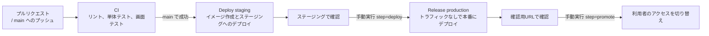

# 営業日報システム CI/CD 設定手順書

> 更新日: 2026-11-14 / 状態: 初版(リマインドとバックアップの定期実行を追加)
> 構成は [tech-stack.md](tech-stack.md) を参照。

## 1. 全体の流れ



| ワークフロー | ファイル | 実行のきっかけ | 内容 |
| --- | --- | --- | --- |
| CI | `.github/workflows/ci.yml` | プルリクエスト、main へのプッシュ | `pnpm check`、`pnpm typecheck`、`pnpm test:coverage`(データベースを使うAPIテストを含む)、マイグレーションの確認、`pnpm test:e2e`(API、画面、データベースを起動して実行)、イメージのビルドと起動の確認(「Container image」)、バックアップのイメージで書き出しと復元の確認(「Backup image」) |
| Deploy staging | `.github/workflows/deploy.yml` | main の CI が成功したとき | Docker イメージを作って Artifact Registry に保存し、ステージングにデプロイする。リマインドとバックアップのジョブも更新する(2.7、2.8) |
| Release production | `.github/workflows/release.yml` | 手動実行(Actions 画面の「Run workflow」)と承認 | `step=deploy` でトラフィックなしで本番にデプロイし(バックアップのジョブも更新する)、`step=promote` で切り替える(リマインドのジョブも更新する。2.8) |
| Check Google Cloud access | `.github/workflows/gcp-auth-check.yml` | 手動実行 | Workload Identity 連携で認証できるか、デプロイに使う権限があるかを、読み取りだけで確かめる(3.4) |

- 本番へのデプロイは手動実行とし、さらに `production` の Environment の承認者(Required reviewers)が承認してから動くようにする。リポジトリは公開のため、GitHub の無料プランでも承認者を設定できる。誤った実行や、ステージングで確認していないバージョンの公開を防ぐため
- イメージはリポジトリの直下の `Dockerfile` で作る。画面のビルド結果と API を1つのイメージにまとめ、API が `/api` 以外の URL で画面を配信する(5章)
- 「Container image」と「Backup image」は、ブランチの保護で必須にはしていない(3.3)。イメージを変えたプルリクエストでは、成功を確かめてからマージする
- Google Cloud への認証は Workload Identity 連携を使い、サービスアカウントのキーは発行しない

## 2. Google Cloud の初期設定

以下のコマンドは一度だけ実行する。`PROJECT_ID`、`PROJECT_NUMBER`、`OWNER`(GitHub のユーザー名か組織名。このリポジトリは `sakaishizue`)は実際の値に置き換える。

- コマンドは、手元の PC に [Google Cloud CLI](https://cloud.google.com/sdk/docs/install)(`gcloud`)を入れて実行するか、Google Cloud のコンソールの Cloud Shell で実行する
- 設定は、プロジェクトのオーナーの Google アカウントで行う(`gcloud auth login`)

### 2.1 プロジェクトの作成と API の有効化

Cloud Run などを使うには、プロジェクトに請求先アカウントを紐づける必要がある(無料枠の範囲でも必要)。プロジェクトIDは世界で一意のため、`nippo-` の後に組織名などを付ける。

```bash
gcloud projects create PROJECT_ID --name=nippo
gcloud billing accounts list
gcloud billing projects link PROJECT_ID --billing-account=BILLING_ACCOUNT_ID
gcloud projects describe PROJECT_ID --format="value(projectNumber)"
```

- 最後のコマンドで表示される番号が `PROJECT_NUMBER`。3.1 のリポジトリの変数にも使う

```bash
gcloud config set project PROJECT_ID
gcloud services enable run.googleapis.com artifactregistry.googleapis.com iam.googleapis.com iamcredentials.googleapis.com secretmanager.googleapis.com
```

### 2.2 イメージの保管場所

```bash
gcloud artifacts repositories create nippo --repository-format=docker --location=asia-southeast1
```

### 2.3 サービスアカウント

| サービスアカウント | 用途 | 付与するロール |
| --- | --- | --- |
| `github-deployer` | GitHub Actions がデプロイに使う | Cloud Run 管理者、Artifact Registry 書き込み、`nippo-runtime` のサービスアカウントユーザー |
| `nippo-runtime` | Cloud Run のアプリが動作に使う | Secret Manager のシークレットへのアクセス |

```bash
gcloud iam service-accounts create github-deployer
gcloud iam service-accounts create nippo-runtime

gcloud projects add-iam-policy-binding PROJECT_ID --member="serviceAccount:github-deployer@PROJECT_ID.iam.gserviceaccount.com" --role="roles/run.admin"
gcloud projects add-iam-policy-binding PROJECT_ID --member="serviceAccount:github-deployer@PROJECT_ID.iam.gserviceaccount.com" --role="roles/artifactregistry.writer"
gcloud iam service-accounts add-iam-policy-binding nippo-runtime@PROJECT_ID.iam.gserviceaccount.com --member="serviceAccount:github-deployer@PROJECT_ID.iam.gserviceaccount.com" --role="roles/iam.serviceAccountUser"
```

### 2.4 Workload Identity 連携

GitHub の指定したリポジトリからだけ、`github-deployer` を使えるようにする。

```bash
gcloud iam workload-identity-pools create github --location=global

gcloud iam workload-identity-pools providers create-oidc github-actions --location=global --workload-identity-pool=github --issuer-uri="https://token.actions.githubusercontent.com" --attribute-mapping="google.subject=assertion.sub,attribute.repository=assertion.repository" --attribute-condition="assertion.repository=='OWNER/nippo'"

gcloud iam service-accounts add-iam-policy-binding github-deployer@PROJECT_ID.iam.gserviceaccount.com --role="roles/iam.workloadIdentityUser" --member="principalSet://iam.googleapis.com/projects/PROJECT_NUMBER/locations/global/workloadIdentityPools/github/attribute.repository/OWNER/nippo"
```

### 2.5 データベース(Neon)と接続文字列

[Neon のコンソール](https://console.neon.tech)で、本番用とステージング用の2つのプロジェクトを作る(技術選定書 3.4、3.7)。

| 項目 | 本番用 | ステージング用 |
| --- | --- | --- |
| プロジェクト名 | `nippo` | `nippo-staging` |
| リージョン | AWS Asia Pacific(Singapore) | AWS Asia Pacific(Singapore) |
| Postgres のバージョン | 最新 | 本番と同じ |
| 計算サイズ | 最小 0.25CU、最大 0.25CU(固定) | 本番と同じ |
| 自動停止(Scale to zero) | 有効(既定のまま) | 有効(既定のまま) |

- データベース名は既定の `neondb` のままでよい
- 「Connect」で表示される接続文字列のうち、アプリには接続プール用(ホスト名に `-pooler` が付くもの)を使う。マイグレーションには直接接続の接続文字列を使う(ステージングと本番へのマイグレーションの手順は、5章の「マイグレーション」で追加する)
- 接続文字列にはパスワードが含まれるため、ファイルやチャットに貼らない。次の Secret Manager への登録で、画面に直接貼り付ける

本番用とステージング用の接続文字列を、Secret Manager に登録する。アプリは接続プール用、マイグレーションは直接接続用を使う(接続プール用では、マイグレーションの排他ができないため)。

| シークレット名 | 内容 | 読むサービスアカウント |
| --- | --- | --- |
| `nippo-database-url` | 本番用プロジェクトの接続文字列(接続プール用) | `nippo-runtime`(アプリ) |
| `nippo-staging-database-url` | ステージング用プロジェクトの接続文字列(接続プール用) | `nippo-runtime`(アプリ) |
| `nippo-database-direct-url` | 本番用プロジェクトの接続文字列(直接接続) | `github-deployer`(デプロイの前のマイグレーション)、`nippo-backup`(バックアップ、2.7) |
| `nippo-staging-database-direct-url` | ステージング用プロジェクトの接続文字列(直接接続) | `github-deployer`(デプロイの前のマイグレーション)、`nippo-backup-staging`(バックアップ、2.7) |

接続文字列は、画面に表示せず、シェルの履歴やファイルにも残さないように登録する。`read -rs` は入力した文字を表示せず、最後の改行も含めない(改行が入ると、接続に失敗する)。

```bash
read -rs DB_URL
printf "%s" "$DB_URL" | gcloud secrets create nippo-staging-database-url --data-file=-
unset DB_URL
```

- 1行目を実行したら、Neon の「Connect」で接続プール用(Connection pooling を有効)の接続文字列をコピーして貼り付け、Enter を押す
- Windows の PowerShell には `read` がないため、次のようにする。PowerShell のパイプは最後に改行を付けるため、一時ファイルに改行なしで書いて渡し、すぐに消す

```powershell
$secure = Read-Host -AsSecureString "接続文字列"
$path = Join-Path $env:TEMP "nippo-db-url.txt"
[System.IO.File]::WriteAllText($path, [System.Net.NetworkCredential]::new("", $secure).Password)
gcloud secrets create nippo-staging-database-url --data-file="$path"
Remove-Item $path
```

- 本番用は、シークレット名を `nippo-database-url` にして同じように登録する
- 直接接続用は、Neon の「Connect」で Connection pooling を無効にした接続文字列(ホスト名に `-pooler` が付かないもの)を、シークレット名を `nippo-staging-database-direct-url`、`nippo-database-direct-url` にして同じように登録する
- シークレットが既にある場合(登録し直す場合)は、`gcloud secrets create` の代わりに `gcloud secrets versions add nippo-staging-database-url --data-file=-` を使う

```bash
gcloud secrets add-iam-policy-binding nippo-database-url --member="serviceAccount:nippo-runtime@PROJECT_ID.iam.gserviceaccount.com" --role="roles/secretmanager.secretAccessor"
gcloud secrets add-iam-policy-binding nippo-staging-database-url --member="serviceAccount:nippo-runtime@PROJECT_ID.iam.gserviceaccount.com" --role="roles/secretmanager.secretAccessor"

gcloud secrets add-iam-policy-binding nippo-database-direct-url --member="serviceAccount:github-deployer@PROJECT_ID.iam.gserviceaccount.com" --role="roles/secretmanager.secretAccessor"
gcloud secrets add-iam-policy-binding nippo-staging-database-direct-url --member="serviceAccount:github-deployer@PROJECT_ID.iam.gserviceaccount.com" --role="roles/secretmanager.secretAccessor"
```

- 権限はシークレットごとに付ける。`nippo-runtime` は直接接続用を読めず、`github-deployer` は接続プール用を読めない

- 登録できたかは、値を表示せずに `gcloud secrets versions list nippo-staging-database-url` で確かめる

### 2.6 初期管理者の作成(要件定義書 F-04)

画面からは管理者がいないとユーザーを登録できないため、ステージングと本番のそれぞれで、最初の管理者を一度だけコマンドで作る。マイグレーションを適用した後(デプロイが一度成功した後)に、リポジトリを取得した手元の PC から実行する。

```bash
export DATABASE_URL="$(gcloud secrets versions access latest --secret=nippo-staging-database-url)"
pnpm --filter @nippo/api create-admin --name "管理者の氏名" --email admin@example.com
unset DATABASE_URL
```

Windows の PowerShell では、次のようにする。

```powershell
$env:DATABASE_URL = gcloud secrets versions access latest --secret=nippo-staging-database-url
pnpm.cmd --filter @nippo/api create-admin --name "管理者の氏名" --email admin@example.com
Remove-Item Env:DATABASE_URL
```

- 環境変数 `DATABASE_URL` は、`apps/api/.env` の値より優先される。終わったら必ず消す(消し忘れると、手元の開発でステージングや本番のデータベースにつながる)

- 本番では、シークレット名を `nippo-database-url` にする
- パスワードはコマンドの実行後に画面で入力する(入力した文字は表示されない)。シェルの履歴に残らないよう、引数(`--password`)では指定できない
- 端末がない環境では、環境変数 `ADMIN_PASSWORD` で渡せる。ただしコマンドの行に直接書くとシェルの履歴に残るため、通常は画面で入力する
- 同じメールアドレスのユーザーがいるとエラーになる。2人目以降の管理者は、画面のユーザー管理から登録する

### 2.7 バックアップ(要件定義書 5章、技術選定書 3.5)

Cloud Run ジョブで毎日、データベースの全データを `pg_dump` で書き出し(custom 形式。圧縮済み)、Cloud Storage のバケットに保存する。7日を過ぎたファイルは自動で削除する(技術選定書 7章)。復元の手順は6章。

| 項目 | 本番用 | ステージング用 |
| --- | --- | --- |
| Cloud Run ジョブ | `nippo-backup` | `nippo-backup-staging` |
| サービスアカウント | `nippo-backup` | `nippo-backup-staging` |
| 読む接続文字列 | `nippo-database-direct-url` | `nippo-staging-database-direct-url` |
| 保存先のバケット | `PROJECT_ID-backup` | `PROJECT_ID-staging-backup` |
| 定期実行 | Cloud Scheduler で毎日3時(日本時間)(2.8) | しない。確認するときに手動で実行する(技術選定書 3.7) |

- ジョブのイメージは `backup/Dockerfile`(PostgreSQL の公式イメージに `backup/backup.sh` を入れたもの)。Deploy staging がイメージを作ってステージングのジョブを更新し、Release production の `step=deploy` が同じイメージで本番のジョブを更新する。ジョブの設定(接続文字列、バケット、タイムアウトなど)はワークフローに書いてある
- `pg_dump` は、データベースと同じか新しい版の PostgreSQL でないと書き出せない。イメージは PostgreSQL 18。Neon のプロジェクトの「Settings」で Postgres のバージョンが18以下であることを確かめる。Neon を19以上にするときは、先に `backup/Dockerfile` の版を上げる
- ジョブのサービスアカウントは、自分の環境の直接接続の接続文字列と、自分の環境のバケットへの書き込み(作成のみ)だけができる。バックアップの上書きや削除はできない
- 本番とステージングでサービスアカウントとバケットを分け、ステージングのジョブからは本番のデータに触れないようにする

以下は、Deploy staging が新しいジョブを作る前(このワークフローの変更を main にマージする前)に実行する。

```bash
gcloud services enable storage.googleapis.com monitoring.googleapis.com

gcloud storage buckets create gs://PROJECT_ID-backup --location=asia-southeast1 --uniform-bucket-level-access --public-access-prevention
gcloud storage buckets create gs://PROJECT_ID-staging-backup --location=asia-southeast1 --uniform-bucket-level-access --public-access-prevention
gcloud storage buckets update gs://PROJECT_ID-backup --lifecycle-file=backup/lifecycle.json
gcloud storage buckets update gs://PROJECT_ID-staging-backup --lifecycle-file=backup/lifecycle.json

gcloud iam service-accounts create nippo-backup
gcloud iam service-accounts create nippo-backup-staging

gcloud storage buckets add-iam-policy-binding gs://PROJECT_ID-backup --member="serviceAccount:nippo-backup@PROJECT_ID.iam.gserviceaccount.com" --role="roles/storage.objectCreator"
gcloud storage buckets add-iam-policy-binding gs://PROJECT_ID-staging-backup --member="serviceAccount:nippo-backup-staging@PROJECT_ID.iam.gserviceaccount.com" --role="roles/storage.objectCreator"
gcloud secrets add-iam-policy-binding nippo-database-direct-url --member="serviceAccount:nippo-backup@PROJECT_ID.iam.gserviceaccount.com" --role="roles/secretmanager.secretAccessor"
gcloud secrets add-iam-policy-binding nippo-staging-database-direct-url --member="serviceAccount:nippo-backup-staging@PROJECT_ID.iam.gserviceaccount.com" --role="roles/secretmanager.secretAccessor"

gcloud iam service-accounts add-iam-policy-binding nippo-backup@PROJECT_ID.iam.gserviceaccount.com --member="serviceAccount:github-deployer@PROJECT_ID.iam.gserviceaccount.com" --role="roles/iam.serviceAccountUser"
gcloud iam service-accounts add-iam-policy-binding nippo-backup-staging@PROJECT_ID.iam.gserviceaccount.com --member="serviceAccount:github-deployer@PROJECT_ID.iam.gserviceaccount.com" --role="roles/iam.serviceAccountUser"
```

- `--lifecycle-file` はリポジトリのファイルを指すため、リポジトリのフォルダで実行する(Cloud Shell では、`backup/lifecycle.json` の内容のファイルを作ってから実行する)
- 最後の2行は、GitHub Actions(`github-deployer`)がジョブにこのサービスアカウントを設定するために要る
- 設定したら「Check Google Cloud access」を実行し、「Read the backup service accounts」が成功することを確かめる(3.4)

**失敗の通知(テスト仕様書 NFR-12)**

Cloud Run ジョブの実行が失敗したら、Cloud Monitoring からメールで知らせる。リマインドのジョブ(#47)の失敗も、同じ設定で知らせる。

```bash
gcloud beta monitoring channels create --display-name="nippo admin" --type=email --channel-labels=email_address=EMAIL
gcloud beta monitoring channels list --format="value(name,displayName)"
gcloud monitoring policies create --policy-from-file=backup/alert-policy.json --notification-channels=CHANNEL_NAME
```

- `EMAIL` は通知を受け取るメールアドレス。1行目の結果(または2行目)で表示される `projects/PROJECT_ID/notificationChannels/数字` を `CHANNEL_NAME` にする
- 表示名は英字にする。Windows の PowerShell では、日本語の引数が gcloud に正しく渡らず、通知先を作れないことがある
- アラートの条件は `backup/alert-policy.json`。ジョブの実行(再試行を含めて最後まで失敗したもの)が1件でもあれば通知する

**動作の確認(ステージング)**

```bash
gcloud run jobs execute nippo-backup-staging --region=asia-southeast1 --wait
gcloud storage ls -l gs://PROJECT_ID-staging-backup/
```

- 実行が成功し、バケットに `nippo-年月日T時分秒Z.dump`(日時は UTC)ができていればよい。ログは Cloud Run のコンソールのジョブの「ログ」で見られる
- 失敗の通知は、存在しないバケットを指定して実行し、失敗させて確かめる。数分後にメールが届く

```bash
gcloud run jobs execute nippo-backup-staging --region=asia-southeast1 --update-env-vars=BUCKET=PROJECT_ID-no-such-bucket --wait
```

### 2.8 定期実行(リマインドとバックアップ)

本番だけ、Cloud Scheduler から Cloud Run ジョブを定期的に起動する。ステージングは定期実行せず、確認するときに手動で実行する(技術選定書 3.7)。

| Cloud Scheduler のジョブ | 起動する Cloud Run ジョブ | 時刻(日本時間) | スケジュール |
| --- | --- | --- | --- |
| `nippo-reminder` | `nippo-reminder`(未提出のリマインド、要件定義書 F-54) | 平日の9時 | `0 9 * * 1-5` |
| `nippo-backup` | `nippo-backup`(2.7) | 毎日3時 | `0 3 * * *` |

- リマインドのジョブは、アプリと同じイメージで `node dist/reminder.js` を実行する。サービスアカウントはアプリと同じ `nippo-runtime` で、接続プール用の接続文字列を読む。ステージングは `nippo-reminder-staging`
- リマインドのジョブは、Deploy staging がステージング、Release production の `step=promote`(初回は `step=deploy`)が本番を更新する。利用者に通知を作るため、アプリの切り替えに合わせる
- 祝日はジョブの中で判定して何もしない。同じ日に何度実行しても、同じ人へのリマインドは1件だけ
- Cloud Scheduler の無料枠は、請求先アカウントごとに月3ジョブ。本番の2つで収まる(ステージングに設定しないのはこのため)
- 起動には専用のサービスアカウント `nippo-scheduler` を使い、この2つのジョブを実行する権限(Cloud Run 起動元)だけを付ける
- 失敗は 2.7 の通知で知らせる(Cloud Run ジョブの失敗を対象にしているため、リマインドも含む)

以下は、本番の初回のリリース(4章)で `nippo-reminder` と `nippo-backup` のジョブができた後に、一度だけ実行する。

```bash
gcloud services enable cloudscheduler.googleapis.com
gcloud iam service-accounts create nippo-scheduler

gcloud run jobs add-iam-policy-binding nippo-reminder --region=asia-southeast1 --member="serviceAccount:nippo-scheduler@PROJECT_ID.iam.gserviceaccount.com" --role="roles/run.invoker"
gcloud run jobs add-iam-policy-binding nippo-backup --region=asia-southeast1 --member="serviceAccount:nippo-scheduler@PROJECT_ID.iam.gserviceaccount.com" --role="roles/run.invoker"

gcloud scheduler jobs create http nippo-reminder --location=asia-southeast1 --schedule="0 9 * * 1-5" --time-zone="Asia/Tokyo" --uri="https://run.googleapis.com/v2/projects/PROJECT_ID/locations/asia-southeast1/jobs/nippo-reminder:run" --http-method=POST --oauth-service-account-email="nippo-scheduler@PROJECT_ID.iam.gserviceaccount.com"
gcloud scheduler jobs create http nippo-backup --location=asia-southeast1 --schedule="0 3 * * *" --time-zone="Asia/Tokyo" --uri="https://run.googleapis.com/v2/projects/PROJECT_ID/locations/asia-southeast1/jobs/nippo-backup:run" --http-method=POST --oauth-service-account-email="nippo-scheduler@PROJECT_ID.iam.gserviceaccount.com"
```

**動作の確認**

設定の直後に、時刻を待たずに1回起動して、権限が正しいかを確かめる。

```bash
gcloud scheduler jobs run nippo-backup --location=asia-southeast1
gcloud run jobs executions list --job=nippo-backup --region=asia-southeast1 --limit=3
```

- 新しい実行ができて、しばらくすると成功(`SUCCEEDED` の欄が1)になればよい。権限が足りないと実行ができず、`gcloud scheduler jobs describe nippo-backup --location=asia-southeast1` の `status` にエラーが出る
- リマインドも同じように `nippo-reminder` で確かめられる。営業日に実行すると、本番の利用者に前営業日のリマインドが作られる(9時の実行と同じ内容で、同じ日に2件にはならない)
- 翌日以降、`gcloud run jobs executions list` で、設定した時刻に実行されていることを確かめる

ステージングのリマインドは、次のように手動で実行する。実行日の前営業日の日報が未提出の一般のユーザーに、通知が作られる。

```bash
gcloud run jobs execute nippo-reminder-staging --region=asia-southeast1 --wait
```

## 3. GitHub の設定

### 3.1 リポジトリの変数(Settings → Secrets and variables → Actions → Variables)

| 変数名 | 値 |
| --- | --- |
| `GCP_PROJECT_ID` | Google Cloud のプロジェクトID |
| `GCP_WORKLOAD_IDENTITY_PROVIDER` | `projects/PROJECT_NUMBER/locations/global/workloadIdentityPools/github/providers/github-actions` |
| `GCP_SERVICE_ACCOUNT` | `github-deployer@PROJECT_ID.iam.gserviceaccount.com` |
| `GCP_RUNTIME_SERVICE_ACCOUNT` | `nippo-runtime@PROJECT_ID.iam.gserviceaccount.com` |

- どれも秘密情報ではないため、シークレットではなく変数に登録する

### 3.2 Environment(Settings → Environments)

| Environment | 設定 |
| --- | --- |
| `staging` | 作成のみ |
| `production` | 「Deployment branches」を `main` のみに制限する。「Required reviewers」にリリースの承認者(`sakaishizue`)を設定する。承認者は自分の実行も承認できるようにする(「Prevent self-review」は外す) |

### 3.3 ブランチの保護(Settings → Branches)

`main` に対して、次のルールを設定する。

- プルリクエストを必須にする(レビューの承認は必須にしない。開発者が1人のため)
- CI の「Lint and unit tests」、「Database migrations」、「E2E tests」の成功を必須にする
- 「Require branches to be up to date before merging」は有効にしない。積み重ねたプルリクエストを順にマージするときに、毎回マージ元を更新し直す必要が出るため
- 管理者にもルールを適用する(「Do not allow bypassing the above settings」)

### 3.4 設定の確認

2章(2.7 を含む)と3.1、3.2の設定が終わったら、Actions 画面で「Check Google Cloud access」を手動で実行する。次のすべてが成功すれば、設定は完了。

| 手順 | 確かめること |
| --- | --- |
| Check repository variables | 3.1 のリポジトリの変数がそろっている |
| google-github-actions/auth | Workload Identity 連携で `github-deployer` として認証できる(2.4) |
| Read Artifact Registry | イメージの保管場所があり、書き込みのロールで読める(2.2、2.3) |
| Read Cloud Run | Cloud Run 管理者のロールがある(2.3) |
| Read the runtime service account | `nippo-runtime` のサービスアカウントユーザーのロールがある(2.3) |
| Read the backup service accounts | `nippo-backup`、`nippo-backup-staging` があり、サービスアカウントユーザーのロールがある(2.7) |

- 認証で失敗する場合は、2.4 の `OWNER/nippo` がこのリポジトリ(`sakaishizue/nippo`)と一致しているか、`PROJECT_NUMBER` がプロジェクトIDではなく番号になっているかを確かめる
- 認証で `invalid_target` になる場合は、3.1 の `GCP_WORKLOAD_IDENTITY_PROVIDER` のプロジェクト番号に、プール `github` とプロバイダー `github-actions` がない(別のプロジェクトで作った、作成が途中で失敗した)。`gcloud iam workload-identity-pools providers list --workload-identity-pool=github --location=global` で確かめ、なければ 2.4 をやり直す。作った直後は、反映まで数分かかることがある
- 「API [iam.googleapis.com] not enabled」で失敗する場合は、2.1 の API の有効化で `iam.googleapis.com` が抜けている。`gcloud services enable iam.googleapis.com` を実行し、数分待ってから実行し直す

## 4. 本番へのリリース手順

1. main にマージすると、CI の成功後にステージングへ自動でデプロイされる
2. ステージングで画面テストと動作確認を行う
3. Actions 画面で「Release production」を開き、`step=deploy` で実行する。ステージングで確認したコミットのSHAを `sha` に入力する。承認者が「Review deployments」で承認すると動き出し、本番のデータベースにマイグレーションを適用してからデプロイする
4. 実行結果に表示される確認用URLで、表示を確認する。本番のデータベースにつながるため、データを変更する操作はしない
5. 問題がなければ、同じ `sha` で `step=promote` を実行し、承認して、利用者のアクセスを切り替える
6. 問題が起きた場合は、Cloud Run のコンソールで前のリビジョンにトラフィックを戻す

- 初回のリリースだけは、本番のサービスがまだないため、手順3でそのまま利用者に公開される。リマインドのジョブもこのときに作られる。初回のリリースの後に、2.6(初期管理者)と 2.8(定期実行)を設定する

## 5. アプリ作成時に追加すること

| 項目 | 内容 |
| --- | --- |
| `Dockerfile` | 追加済み。3段階でビルドする(1. 依存パッケージを入れて画面と API をビルド、2. `@node-rs/argon2`(ネイティブモジュール)だけを入れる、3. ビルドした画面(`public/`)と API(`dist/`)と、2 の node_modules だけをまとめる)。環境変数 `WEB_DIR=public` で API が画面を配信し、`PORT`(Cloud Run が渡す。既定は8080)で待ち受ける。`node` ユーザー(root 以外)で動かす。リマインドのジョブも同じイメージで `node dist/reminder.js` を実行する |
| マイグレーション | 追加済み。Deploy staging はイメージを作った後、Release production は `step=deploy` で承認された後に、`nippo-staging-database-direct-url` か `nippo-database-direct-url` を読んで `prisma migrate deploy` を実行してから、新しいバージョンをデプロイする。マイグレーションが失敗したらデプロイしない。古いバージョンでも動くマイグレーションにする(CLAUDE.md) |
| バックアップ | 追加済み(2.7、6章)。`backup/Dockerfile` のイメージを、Deploy staging がステージングのジョブ、Release production が本番のジョブにデプロイする。CI の「Backup image」で、イメージで書き出してから別のデータベースに復元できることを確かめる |
| 定期処理 | 追加済み(2.8)。リマインドは API と同じイメージで `node dist/reminder.js` を実行するジョブ(`nippo-reminder-staging`、`nippo-reminder`)にし、Deploy staging と Release production が更新する。本番だけ Cloud Scheduler から、リマインドを平日の朝9時、バックアップを毎日3時(日本時間)に起動する。祝日はジョブの中で判定して何もしない |

## 6. バックアップからの復元

バックアップのファイル(2.7)を、新しい Neon のプロジェクトに復元する。手元の PC には PostgreSQL がないため、Google Cloud のコンソールの Cloud Shell(Docker が使える)で、バックアップのイメージと同じ版の PostgreSQL の公式イメージを使って `pg_restore` を実行する。

**1. 復元先を作る**

Neon のコンソールで、復元先のプロジェクトを作る(2.5 と同じ設定。名前は `nippo-restore` など)。復元の確認(テスト仕様書 NFR-11)のときは一時的なプロジェクトにし、確認後に削除する。

**2. Cloud Shell で復元する**

```bash
gcloud config set project PROJECT_ID
gcloud storage ls -l gs://PROJECT_ID-staging-backup/
gcloud storage cp gs://PROJECT_ID-staging-backup/FILE .
read -rs RESTORE_URL
docker run --rm -e RESTORE_URL -v "$PWD:/backup:ro" postgres:18.6-alpine sh -c 'pg_restore --no-owner --no-acl --exit-on-error --dbname="$RESTORE_URL" "/backup/$0"' FILE
unset RESTORE_URL
rm FILE
```

- 本番のバックアップは、バケットを `PROJECT_ID-backup` にする。`FILE` は2行目で表示されるファイル名(`nippo-20261115T180000Z.dump` など)。日時は UTC
- `read -rs` では、復元先のプロジェクトの直接接続の接続文字列(`-pooler` の付かないもの)を貼り付けて Enter を押す。画面と履歴に残らない
- テーブル、データ、マイグレーションの履歴(`_prisma_migrations`)がそのまま戻る。エラーが出たら途中で止まる(`--exit-on-error`)。その場合は、復元先のプロジェクトを作り直してからやり直す
- バックアップのファイルには実データが入っているため、Cloud Shell に残さない(最後の行で消す)

**3. 復元したデータを画面で確かめる**

手元の PC で、復元先のデータベースにつないで API と画面を起動し、ログインして日報を開く。PowerShell では次のようにする。

```powershell
$secure = Read-Host -AsSecureString "接続文字列"
$env:DATABASE_URL = [System.Net.NetworkCredential]::new("", $secure).Password
pnpm.cmd dev
Remove-Item Env:DATABASE_URL
```

- 接続文字列は、復元先のプロジェクトの接続プール用を貼り付ける。`http://localhost:5173` を開き、バックアップを取った環境のユーザーでログインする
- 確認が終わったら `Ctrl+C` で止め、最後の行で環境変数を消す(2.6 と同じ理由)
- 復元の確認(NFR-11)では、事前にステージングで日報を提出しておき、管理者でログインしてその日報を開けることを確かめる。確認後、Neon のコンソールで一時的なプロジェクトを削除する

**本番のデータベースを入れ替える場合**

本番のデータが壊れた場合などは、復元したプロジェクトを本番として使う。2.5 の手順で `nippo-database-url` と `nippo-database-direct-url` に新しいバージョン(`gcloud secrets versions add`)を登録し、`gcloud run services update nippo --region=asia-southeast1 --update-labels=restored-at=日付` などで新しいリビジョンを作って、新しい接続文字列を読み込ませる。
