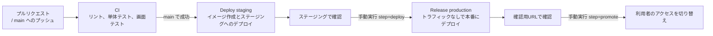

# 営業日報システム CI/CD 設定手順書

> 更新日: 2026-11-07 / 状態: 初版
> 構成は [tech-stack.md](tech-stack.md) を参照。

## 1. 全体の流れ



| ワークフロー | ファイル | 実行のきっかけ | 内容 |
| --- | --- | --- | --- |
| CI | `.github/workflows/ci.yml` | プルリクエスト、main へのプッシュ | `pnpm check`、`pnpm test:coverage`、`pnpm test:e2e` |
| Deploy staging | `.github/workflows/deploy.yml` | main の CI が成功したとき | Docker イメージを作って Artifact Registry に保存し、ステージングにデプロイする |
| Release production | `.github/workflows/release.yml` | 手動実行(Actions 画面の「Run workflow」) | `step=deploy` でトラフィックなしで本番にデプロイし、`step=promote` で切り替える |

- 本番へのデプロイは手動実行とする。GitHub の無料プランのプライベートリポジトリでは、Environment の承認者設定が使えないため
- `Dockerfile` がまだないため、Deploy staging はスキップされる。アプリを作成して `Dockerfile` を追加すると動き出す
- Google Cloud への認証は Workload Identity 連携を使い、サービスアカウントのキーは発行しない

## 2. Google Cloud の初期設定

以下のコマンドは一度だけ実行する。`PROJECT_ID`、`PROJECT_NUMBER`、`OWNER`(GitHub のユーザー名か組織名)は実際の値に置き換える。

### 2.1 API の有効化

```bash
gcloud config set project PROJECT_ID
gcloud services enable run.googleapis.com artifactregistry.googleapis.com iamcredentials.googleapis.com secretmanager.googleapis.com
```

### 2.2 イメージの保管場所

```bash
gcloud artifacts repositories create nippo --repository-format=docker --location=asia-southeast1
```

### 2.3 サービスアカウント

| サービスアカウント | 用途 | 付与するロール |
| --- | --- | --- |
| `github-deployer` | GitHub Actions がデプロイに使う | Cloud Run 管理者、Artifact Registry 書き込み、`nippo-runtime` のサービスアカウントユーザー |
| `nippo-runtime` | Cloud Run のアプリが動作に使う | Secret Manager のシークレットへのアクセス |

```bash
gcloud iam service-accounts create github-deployer
gcloud iam service-accounts create nippo-runtime

gcloud projects add-iam-policy-binding PROJECT_ID --member="serviceAccount:github-deployer@PROJECT_ID.iam.gserviceaccount.com" --role="roles/run.admin"
gcloud projects add-iam-policy-binding PROJECT_ID --member="serviceAccount:github-deployer@PROJECT_ID.iam.gserviceaccount.com" --role="roles/artifactregistry.writer"
gcloud iam service-accounts add-iam-policy-binding nippo-runtime@PROJECT_ID.iam.gserviceaccount.com --member="serviceAccount:github-deployer@PROJECT_ID.iam.gserviceaccount.com" --role="roles/iam.serviceAccountUser"
```

### 2.4 Workload Identity 連携

GitHub の指定したリポジトリからだけ、`github-deployer` を使えるようにする。

```bash
gcloud iam workload-identity-pools create github --location=global

gcloud iam workload-identity-pools providers create-oidc github-actions --location=global --workload-identity-pool=github --issuer-uri="https://token.actions.githubusercontent.com" --attribute-mapping="google.subject=assertion.sub,attribute.repository=assertion.repository" --attribute-condition="assertion.repository=='OWNER/nippo'"

gcloud iam service-accounts add-iam-policy-binding github-deployer@PROJECT_ID.iam.gserviceaccount.com --role="roles/iam.workloadIdentityUser" --member="principalSet://iam.googleapis.com/projects/PROJECT_NUMBER/locations/global/workloadIdentityPools/github/attribute.repository/OWNER/nippo"
```

### 2.5 データベースの接続文字列

Neon の本番用プロジェクトとステージング用プロジェクトの接続文字列(接続プール用)を、Secret Manager に登録する。

| シークレット名 | 内容 |
| --- | --- |
| `nippo-database-url` | 本番用プロジェクトの接続文字列 |
| `nippo-staging-database-url` | ステージング用プロジェクトの接続文字列 |

```bash
gcloud secrets create nippo-database-url --data-file=-
gcloud secrets create nippo-staging-database-url --data-file=-

gcloud secrets add-iam-policy-binding nippo-database-url --member="serviceAccount:nippo-runtime@PROJECT_ID.iam.gserviceaccount.com" --role="roles/secretmanager.secretAccessor"
gcloud secrets add-iam-policy-binding nippo-staging-database-url --member="serviceAccount:nippo-runtime@PROJECT_ID.iam.gserviceaccount.com" --role="roles/secretmanager.secretAccessor"
```

- `--data-file=-` では、コマンドの実行後に接続文字列を貼り付けて入力を終える。接続文字列をコマンドの引数やファイルに残さない

## 3. GitHub の設定

### 3.1 リポジトリの変数(Settings → Secrets and variables → Actions → Variables)

| 変数名 | 値 |
| --- | --- |
| `GCP_PROJECT_ID` | Google Cloud のプロジェクトID |
| `GCP_WORKLOAD_IDENTITY_PROVIDER` | `projects/PROJECT_NUMBER/locations/global/workloadIdentityPools/github/providers/github-actions` |
| `GCP_SERVICE_ACCOUNT` | `github-deployer@PROJECT_ID.iam.gserviceaccount.com` |
| `GCP_RUNTIME_SERVICE_ACCOUNT` | `nippo-runtime@PROJECT_ID.iam.gserviceaccount.com` |

- どれも秘密情報ではないため、シークレットではなく変数に登録する

### 3.2 Environment(Settings → Environments)

| Environment | 設定 |
| --- | --- |
| `staging` | 作成のみ |
| `production` | 「Deployment branches」を `main` のみに制限する |

### 3.3 ブランチの保護(Settings → Branches)

`main` に対して、次のルールを設定する。

- プルリクエストを必須にする
- CI の「Lint and unit tests」、「Database migrations」、「E2E tests」の成功を必須にする

## 4. 本番へのリリース手順

1. main にマージすると、CI の成功後にステージングへ自動でデプロイされる
2. ステージングで画面テストと動作確認を行う
3. Actions 画面で「Release production」を開き、`step=deploy` で実行する。ステージングで確認したコミットのSHAを `sha` に入力する
4. 実行結果に表示される確認用URLで、表示を確認する。本番のデータベースにつながるため、データを変更する操作はしない
5. 問題がなければ、同じ `sha` で `step=promote` を実行し、利用者のアクセスを切り替える
6. 問題が起きた場合は、Cloud Run のコンソールで前のリビジョンにトラフィックを戻す

- 初回のリリースだけは、本番のサービスがまだないため、手順3でそのまま利用者に公開される

## 5. アプリ作成時に追加すること

| 項目 | 内容 |
| --- | --- |
| `Dockerfile` | 画面のビルドとAPIをまとめたイメージを作る。追加するとステージングへのデプロイが動き出す |
| CI の画面テスト | アプリの起動と、テスト用データベース(PostgreSQL のサービスコンテナ)を追加する |
| マイグレーション | デプロイの前に、Prisma のマイグレーションを実行する手順を追加する |
| 定期処理 | リマインドとバックアップの Cloud Scheduler、Cloud Run ジョブを設定する |
