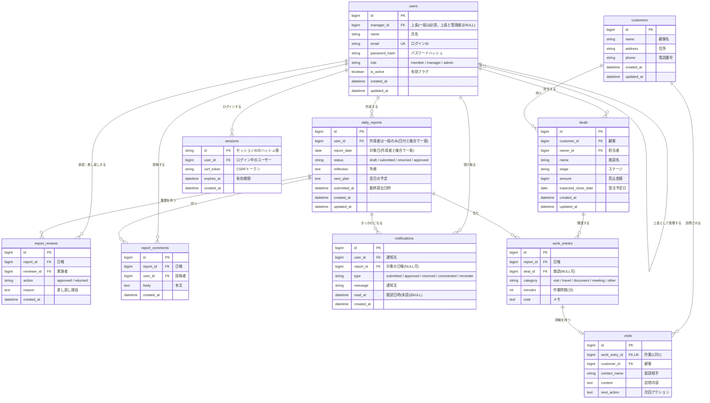

# 営業日報システム 要件定義書

> 更新日: 2026-11-07 / 状態: 初版(画面定義での決定事項を反映)

## 1. 目的

営業担当者の日々の活動(顧客訪問、商談の進捗、作業時間)を記録し、上長が確認とフィードバックを行えるようにする。

- 営業活動の状況を、上長がタイムリーに把握できる
- 顧客や商談ごとの活動履歴を、後から振り返れる
- どの顧客、商談、業務に時間を使っているかを集計できる

## 2. 利用者と権限

| ロール | 主な利用者         | できること                                                             |
| ------ | ------------------ | ---------------------------------------------------------------------- |
| 一般   | 営業担当者         | 自分の日報の作成と提出、自分の作業時間の参照、コメント                 |
| 上長   | 営業マネージャー   | 直属の部下の日報の閲覧、承認、差し戻し、コメント、部下の作業時間の集計 |
| 管理者 | システム管理担当者 | ユーザーの登録、編集、無効化、ロールと上長の設定、全員の日報の閲覧     |

- 日報を書くのは一般のみとする。上長と管理者は日報を書かない
- 一般には必ず上長を1名設定する。上長と管理者には上長を設定しない
- 管理者の日報の権限は閲覧のみとする。承認、差し戻し、コメントはできない
- 日報を閲覧できるのは本人、直属の上長、管理者のみとする。一般は他の営業担当者の日報を閲覧できない
- 上長と管理者が閲覧できるのは、提出済み以降の日報のみとする。下書きは本人だけが閲覧できる
- 例外として、訪問記録は顧客や商談の詳細画面で全員に共有する。所感、翌日の予定、作業時間、コメントは共有しない
- 顧客と商談は全員が参照、登録、編集できる

## 3. 業務の流れ

1. 営業担当者が、訪問内容と作業時間を日報に入力する(途中で下書き保存できる)
2. 営業担当者が日報を提出すると、上長に通知される
3. 上長が内容を確認し、承認または差し戻しを行う。結果は担当者に通知される
4. 差し戻された場合、担当者は修正して再提出する

### 日報のステータス

| ステータス  | 意味     | 本人による編集 | 次のステータス          |
| ----------- | -------- | -------------- | ----------------------- |
| `draft`     | 下書き   | 可             | `submitted`             |
| `submitted` | 提出済み | 不可           | `approved` / `returned` |
| `returned`  | 差し戻し | 可             | `submitted`             |
| `approved`  | 承認済み | 不可           | なし                    |

## 4. 機能要件

### 4.1 認証・ユーザー

| ID   | 要件                                                                               |
| ---- | ---------------------------------------------------------------------------------- |
| F-01 | メールアドレスとパスワードでログインできる                                         |
| F-02 | ロール(一般、上長、管理者)に応じて操作を制限する                                   |
| F-03 | 管理者はユーザーの登録、編集、無効化ができる。過去の日報を残すため物理削除はしない |
| F-04 | 最初の管理者は、システムの初期設定時に作成する                                     |
| F-05 | 本人が自分のパスワードを変更できる                                                 |
| F-06 | パスワードを忘れた場合は、管理者がパスワードを再設定する                           |

### 4.2 日報の作成と提出

| ID   | 要件                                                                                     |
| ---- | ---------------------------------------------------------------------------------------- |
| F-11 | 一般は日付ごとに日報を作成できる。1ユーザーにつき1日1件とする                            |
| F-12 | 所感と翌日の予定を入力できる                                                             |
| F-13 | 下書き保存と提出ができる。日報は削除できないが、下書きの間は日付を変更できる             |
| F-14 | 日付、担当者、顧客、ステータス、キーワードで、閲覧権限のある過去の日報を検索、閲覧できる |

### 4.3 訪問記録・顧客・商談

| ID   | 要件                                                                                                                                |
| ---- | ----------------------------------------------------------------------------------------------------------------------------------- |
| F-21 | 日報に複数の訪問記録(顧客、商談、面談相手、内容、次回アクション)を登録できる                                                        |
| F-22 | 顧客の登録、編集、検索ができる                                                                                                      |
| F-23 | 商談(顧客、担当者、商談名、ステージ、見込金額、受注予定日)の登録、編集ができる。ステージは見込み、提案中、交渉中、受注、失注の5段階 |
| F-24 | 顧客や商談の詳細画面で、紐づく訪問記録の履歴を全員が確認できる。対象は提出済みと承認済みの日報の訪問記録とする                      |

### 4.4 作業時間

| ID   | 要件                                                                                                         |
| ---- | ------------------------------------------------------------------------------------------------------------ |
| F-31 | 日報に、作業区分(訪問、移動、資料作成、社内会議、その他)と作業時間(分)を複数登録できる                       |
| F-32 | 作業には任意で商談を紐づけられる                                                                             |
| F-33 | 訪問記録は作業の1件に紐づけ、時間を二重に計上しない                                                          |
| F-34 | 期間を指定して、担当者別、顧客別、商談別、作業区分別に時間を集計できる。対象は提出済みと承認済みの日報とする |

### 4.5 承認・コメント

| ID   | 要件                                                 |
| ---- | ---------------------------------------------------- |
| F-41 | 上長は直属の部下の提出済み日報を承認、差し戻しできる |
| F-42 | 差し戻しの際は理由の入力を必須とする                 |
| F-43 | 承認と差し戻しの履歴(実施者、日時)を保持する         |
| F-44 | 日報の作成者と直属の上長は、その日報にコメントできる |
| F-45 | 上長は未承認の日報を一覧で確認できる                 |

### 4.6 通知

| ID   | 通知のきっかけ                                    | 通知先                                                                     |
| ---- | ------------------------------------------------- | -------------------------------------------------------------------------- |
| F-51 | 日報が提出された                                  | 上長                                                                       |
| F-52 | 日報が承認または差し戻しされた                    | 日報の作成者                                                               |
| F-53 | コメントが付いた                                  | 日報の作成者と上長(投稿者本人を除く。下書きへのコメントは上長に通知しない) |
| F-54 | 平日(土日と祝日を除く)の日報が翌朝9時までに未提出 | 未提出の本人(一般のみ)                                                     |

- アプリ内に通知を表示し、既読と未読を管理する
- 通知手段はアプリ内のみとする

## 5. 非機能要件

| 区分         | 要件                                                                              |
| ------------ | --------------------------------------------------------------------------------- |
| 利用規模     | 利用者は50人以下                                                                  |
| 利用環境     | PCとスマートフォンのWebブラウザ。外出先からスマートフォンで入力しやすい画面にする |
| 性能         | 通常の画面表示は3秒以内                                                           |
| セキュリティ | 通信のHTTPS化、パスワードのハッシュ化、権限チェックをサーバー側で実施             |
| データ保持   | 日報は5年間保持する                                                               |
| バックアップ | 1日1回取得する                                                                    |

## 6. 対象外(初期バージョン)

- 見積や受注などの販売管理
- 商談ステージの変更履歴の管理
- 多段階の承認フロー
- 外部サービス連携(カレンダー、CRM、チャットなど)
- 日報のファイル添付

## 7. ER図

### テーブルの役割

| テーブル          | 役割                                                                                   |
| ----------------- | -------------------------------------------------------------------------------------- |
| `users`           | 利用者。`manager_id` の自己参照で上長と部下の関係を表す                                |
| `customers`       | 顧客                                                                                   |
| `deals`           | 商談。ステージと金額は現在値のみ持つ                                                   |
| `daily_reports`   | 日報の本体                                                                             |
| `work_entries`    | 作業時間。時間の集計はこのテーブルのみを対象とする                                     |
| `visits`          | 訪問の詳細。区分が `visit` の作業に1対1で紐づく                                        |
| `report_reviews`  | 承認と差し戻しの履歴                                                                   |
| `report_comments` | 日報へのコメント                                                                       |
| `notifications`   | ユーザーごとの通知と既読状態                                                           |
| `sessions`        | ログイン中のセッション。Cloud Run ではサーバーが入れ替わるため、データベースに保存する |

### 設計上のポイント

- **訪問と作業時間の分離**: 時間は `work_entries` だけが持ち、`visits` は訪問の詳細のみを持つ。これにより時間の二重計上を防ぐ(F-33)
- **商談の参照**: 商談は `work_entries.deal_id` だけが持ち、訪問の商談は `work_entries` 経由で参照する。これにより訪問と作業で商談が食い違うことを防ぐ
- **日報の一意制約**: `daily_reports` の `(user_id, report_date)` に複合ユニーク制約を設定する(F-11)
- **ロールの制約**: 「日報の作成者は一般のみ」「承認者は作成者の上長のみ」はテーブル定義では表せないため、アプリ側で検証する
- **セッションの保存**: セッションIDはハッシュ値で保存し、データベースが漏えいしてもセッションを乗っ取られないようにする。ログアウト時と有効期限切れのセッションは削除する
