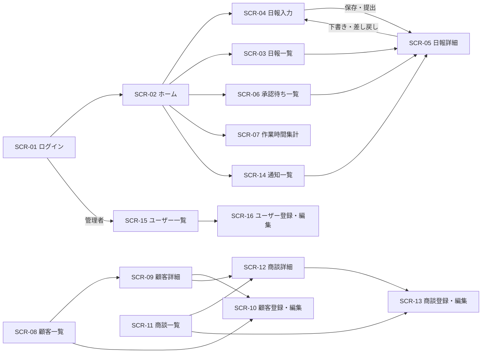

# 営業日報システム 画面定義書

> 更新日: 2026-11-11 / 状態: 初版(管理者がホームを開いた場合を追加)
> 要件は [requirements.md](requirements.md) を参照。

## 1. 画面一覧

| ID     | 画面名             | 一般    | 上長    | 管理者      | 関連要件                 |
| ------ | ------------------ | ------- | ------- | ----------- | ------------------------ |
| SCR-01 | ログイン           | ○       | ○       | ○           | F-01                     |
| SCR-02 | ホーム             | ○       | ○       | -           | F-45                     |
| SCR-03 | 日報一覧           | ○(自分) | ○(部下) | ○(全員)     | F-14                     |
| SCR-04 | 日報入力           | ○       | -       | -           | F-11〜13, F-21, F-31〜33 |
| SCR-05 | 日報詳細           | ○(自分) | ○(部下) | ○(閲覧のみ) | F-41〜44                 |
| SCR-06 | 承認待ち一覧       | -       | ○       | -           | F-45                     |
| SCR-07 | 作業時間集計       | ○(自分) | ○(部下) | -           | F-34                     |
| SCR-08 | 顧客一覧           | ○       | ○       | ○           | F-22                     |
| SCR-09 | 顧客詳細           | ○       | ○       | ○           | F-24                     |
| SCR-10 | 顧客登録・編集     | ○       | ○       | ○           | F-22                     |
| SCR-11 | 商談一覧           | ○       | ○       | ○           | F-23                     |
| SCR-12 | 商談詳細           | ○       | ○       | ○           | F-24                     |
| SCR-13 | 商談登録・編集     | ○       | ○       | ○           | F-23                     |
| SCR-14 | 通知一覧           | ○       | ○       | -           | F-51〜54                 |
| SCR-15 | ユーザー一覧       | -       | -       | ○           | F-03                     |
| SCR-16 | ユーザー登録・編集 | -       | -       | ○           | F-03, F-06               |
| SCR-17 | プロフィール       | ○       | ○       | ○           | F-05                     |

- 権限のない画面のURLに直接アクセスした場合は、エラー画面(403)を表示する
- 管理者には通知が発生しないため、通知一覧は表示しない

### 画面のURL

| 画面 | URL |
| --- | --- |
| SCR-01 ログイン | `/login` |
| SCR-02 ホーム | `/` |
| SCR-03 日報一覧 | `/reports` |
| SCR-04 日報入力 | 新規 `/reports/new`、編集 `/reports/:id/edit` |
| SCR-05 日報詳細 | `/reports/:id` |
| SCR-06 承認待ち一覧 | `/approvals` |
| SCR-07 作業時間集計 | `/summary` |
| SCR-08 顧客一覧 | `/customers` |
| SCR-09 顧客詳細 | `/customers/:id` |
| SCR-10 顧客登録・編集 | 登録 `/customers/new`、編集 `/customers/:id/edit` |
| SCR-11 商談一覧 | `/deals` |
| SCR-12 商談詳細 | `/deals/:id` |
| SCR-13 商談登録・編集 | 登録 `/deals/new`、編集 `/deals/:id/edit` |
| SCR-14 通知一覧 | `/notifications` |
| SCR-15 ユーザー一覧 | `/admin/users` |
| SCR-16 ユーザー登録・編集 | 登録 `/admin/users/new`、編集 `/admin/users/:id` |
| SCR-17 プロフィール | `/profile` |

- 定義していないURLは「ページが見つかりません」を表示する
- 検索条件などは、URLのクエリに保持する(3.4)

## 2. 画面遷移

ヘッダーのメニューからは、ロールごとに利用できる画面へ直接移動できる。下図は主な流れのみを示す。

## 3. 共通仕様

### 3.1 レイアウト

| 領域     | 内容                                                                                                         |
| -------- | ------------------------------------------------------------------------------------------------------------ |
| ヘッダー | システム名、メニュー、通知アイコン(未読件数のバッジ付き)、ログイン中のユーザー名(選ぶとSCR-17へ)、ログアウト |
| メイン   | 各画面の内容                                                                                                 |

| ロール | メニュー項目                                         |
| ------ | ---------------------------------------------------- |
| 一般   | ホーム、日報一覧、作業時間集計、顧客、商談           |
| 上長   | ホーム、承認待ち、日報一覧、作業時間集計、顧客、商談 |
| 管理者 | ユーザー管理、日報一覧、顧客、商談                   |

### 3.2 スマートフォン対応

- 画面幅768px未満では、メニューをハンバーガーメニューに折りたたむ
- 一覧の表はカード形式で表示する
- 数値の入力欄では数字キーボードを表示する
- ボタンなどタップする要素は、高さ44px以上にする

### 3.3 メッセージ

| 種類       | 表示方法                 | 例                                                |
| ---------- | ------------------------ | ------------------------------------------------- |
| 完了       | 画面上部に数秒表示       | 「日報を提出しました」                            |
| 入力エラー | 該当項目の下に赤字で表示 | 「顧客を選択してください」                        |
| 確認       | ダイアログ               | 「提出すると編集できなくなります。提出しますか?」 |

### 3.4 一覧の共通仕様

- 1ページ20件のページ送り
- 検索条件はURLのクエリに保持し、詳細画面から戻ったときに再現する

### 3.5 デザインの方針

画面の見た目の決まり。色や角丸は `apps/web/src/styles/globals.css` のテーマ変数で定義し、画面では変数(Tailwind の `bg-primary` など)を使う。色の値を画面に直接書かない。主要画面のレイアウト案(PC とスマートフォン)は [レイアウト案](https://claude.ai/artifact/G9Fp2dei9DHU8rVbwcZoj2) にある。

**基本**

| 項目         | 決定内容                                                         |
| ------------ | ---------------------------------------------------------------- |
| システム名   | 「営業日報」。ロゴは使わず、ヘッダーとログイン画面に文字で表示する |
| 基本色       | 藍色(インディゴ)                                                 |
| ダークモード | 対応しない(明るい配色のみ)                                       |
| フォント     | OS の標準フォント(Windows は游ゴシック UI とメイリオ、iPhone と Mac はヒラギノ角ゴ、Android は Noto Sans JP) |

**配色**

| 用途                 | 変数                                  | 色                    |
| -------------------- | ------------------------------------- | --------------------- |
| 画面の背景           | `--background`                        | `#F8FAFC`             |
| カード               | `--card`                              | `#FFFFFF`             |
| 文字                 | `--foreground`                        | `#0F172A`             |
| 補足の文字           | `--muted-foreground`                  | `#475569`             |
| 基本色(ボタン、リンク) | `--primary`                         | `#4338CA`(文字は白)  |
| 淡い基本色(選択中など) | `--accent`、`--accent-foreground`   | `#EEF2FF`、`#3730A3`  |
| フォーカスの輪       | `--ring`                              | `#6366F1`             |
| ヘッダー             | `--header`、`--header-active`(選択中のメニュー) | `#3730A3`、`#4F46E5`(文字は白) |
| 境界線               | `--border`                            | `#E2E8F0`             |
| 入力欄の枠           | `--input`                             | `#64748B`             |
| エラー               | `--destructive`、`--destructive-surface` | `#B91C1C`、`#FEF2F2` |
| 完了                 | `--success`、`--success-surface`      | `#166534`、`#F0FDF4`  |
| 警告                 | `--warning`、`--warning-surface`      | `#92400E`、`#FFFBEB`  |

**日報のステータスの色**(SCR-03 などの色付きラベル。背景と文字)

| ステータス | 変数                                         | 色                   |
| ---------- | -------------------------------------------- | -------------------- |
| 下書き     | `--status-draft`、`--status-draft-foreground` | `#F1F5F9`、`#334155` |
| 提出済み   | `--status-submitted`、`--status-submitted-foreground` | `#DBEAFE`、`#1E40AF` |
| 差し戻し   | `--status-returned`、`--status-returned-foreground` | `#FFEDD5`、`#9A3412` |
| 承認済み   | `--status-approved`、`--status-approved-foreground` | `#DCFCE7`、`#166534` |

- ステータスは色だけで区別せず、必ず文字(「差し戻し」など)を添える
- 文字と背景のコントラスト比は WCAG AA(本文 4.5:1 以上)、入力欄の枠やフォーカスの輪は 3:1 以上にする。`apps/web/src/styles/theme.test.ts` で確認する。色を変えたら、このテストに組み合わせを追加する

**文字**

| 用途                       | 大きさ | 太さ |
| -------------------------- | ------ | ---- |
| 画面タイトル               | 20px   | 太字 |
| 見出し                     | 18px(スマートフォンは 16px) | 太字 |
| 本文、入力欄               | 16px   | 標準 |
| 表、ラベル、ボタン(PC)     | 14px   | ラベルは太字 |
| 補足(日時など)             | 12px   | 標準 |

- 太さは標準(400)と太字(700)の2つだけにする。日本語の標準フォントは中間の太さがないものが多いため
- 本文の行の高さは 1.6
- スマートフォンでは、入力欄の文字を 16px 以上にする。iPhone で入力時に画面が拡大されないようにするため

**余白、角丸、影**

| 項目     | 決定内容                                                                 |
| -------- | ------------------------------------------------------------------------ |
| 余白     | 4px 刻み(4、8、12、16、24、32)。画面の左右はスマートフォン 16px、PC 24px。カードの中は 16〜24px |
| 画面の幅 | PC は中身の最大幅 1120px で中央に寄せる                                  |
| 角丸     | ボタンと入力欄は 8px、カードは 12px、ステータスのラベルは丸               |
| 影       | カードに薄い影。ダイアログとスマートフォンのメニューに濃い影。それ以外には付けない |

**部品とレイアウト**

- ボタンなどタップする要素は、PC も含めて高さ 44px 以上にする(3.2)。スマートフォンの主なボタンは 48px
- ヘッダーは藍色で、選択中のメニューは明るい藍の背景で示す。未読の通知の件数は赤いバッジ
- 主な操作のボタンは基本色、取り消しや下書き保存は枠線のボタン、差し戻しはエラーの色の薄い面のボタンにする
- スマートフォンでは、日報入力の「下書き保存」「提出」と合計時間、日報詳細の「承認」「差し戻し」を画面の下に固定する
- 一覧は PC では表、スマートフォンではカード(3.2)。スマートフォンの検索条件は折りたためるようにする

## 4. 画面定義

### SCR-01 ログイン

| 項目           | 種類       | 必須 | 説明 |
| -------------- | ---------- | ---- | ---- |
| メールアドレス | テキスト   | ○    |      |
| パスワード     | パスワード | ○    |      |
| ログイン       | ボタン     |      |      |

- ログインに成功したら、一般と上長はホーム、管理者はユーザー一覧に遷移する
- 失敗した場合は「メールアドレスまたはパスワードが正しくありません」と表示する。どちらが誤りかは示さない
- 無効化されたユーザーはログインできない

### SCR-02 ホーム

ロールによって表示内容が異なる。管理者が開いた場合は、SCR-15 ユーザー一覧へ移動する(管理者のホームはユーザー一覧のため)。

**一般**

| 表示ブロック     | 内容                                                                 | 操作                                                             |
| ---------------- | -------------------------------------------------------------------- | ---------------------------------------------------------------- |
| 今日の日報       | 今日の日報のステータス(未作成、下書き、提出済み、差し戻し、承認済み) | 未作成は「作成する」、下書きと差し戻しは「続きを書く」でSCR-04へ |
| 差し戻し中の日報 | 日付、差し戻し理由                                                   | 行を選ぶとSCR-04へ                                               |
| 最近の日報       | 直近7日分の日付、ステータス、合計時間                                | 行を選ぶとSCR-05へ                                               |

**上長**

| 表示ブロック   | 内容                                 | 操作                 |
| -------------- | ------------------------------------ | -------------------- |
| 承認待ち       | 承認待ちの件数                       | SCR-06へ             |
| 部下の提出状況 | 部下ごとの前営業日と今日のステータス | 日報があればSCR-05へ |

### SCR-03 日報一覧

**検索条件**

| 項目       | 種類             | 説明                                                           |
| ---------- | ---------------- | -------------------------------------------------------------- |
| 期間       | 日付(開始、終了) | 初期値は直近1か月                                              |
| 担当者     | 選択             | 上長は部下、管理者は全員から選ぶ。一般には表示しない           |
| 顧客       | 選択(検索付き)   | 訪問記録の顧客で絞り込む                                       |
| ステータス | 複数選択         |                                                                |
| キーワード | テキスト         | 所感、翌日の予定、訪問内容、次回アクションを部分一致で検索する |

**一覧の項目**

| 項目       | 説明                 |
| ---------- | -------------------- |
| 日付       |                      |
| 担当者     | 一般には表示しない   |
| ステータス | 色付きのラベルで表示 |
| 訪問件数   |                      |
| 合計時間   | 「7時間30分」の形式  |
| コメント数 |                      |

- 日付の新しい順に表示する。行を選ぶとSCR-05へ遷移する
- 表示対象は閲覧権限のある日報のみ。上長と管理者には下書きを表示しない

### SCR-04 日報入力

一般のみが利用する。ステータスが下書きまたは差し戻しの日報だけを編集できる。

**ヘッダー部**

| 項目         | 種類     | 必須 | 説明                                   |
| ------------ | -------- | ---- | -------------------------------------- |
| 日付         | 日付     | ○    | 初期値は今日。下書きの間は変更できる   |
| 差し戻し理由 | 表示のみ |      | 差し戻し中のみ、画面上部に強調して表示 |

**作業(複数行)**

| 項目           | 種類           | 必須 | 説明                                     |
| -------------- | -------------- | ---- | ---------------------------------------- |
| 作業区分       | 選択           | ○    | 訪問、移動、資料作成、社内会議、その他   |
| 時間(分)       | 数値           | ○    |                                          |
| 商談           | 選択(検索付き) |      | 訪問の場合は、選んだ顧客の商談に絞り込む |
| メモ           | テキスト       |      | 500文字以内                              |
| 行の追加、削除 | ボタン         |      |                                          |

**訪問の詳細(作業区分が「訪問」の行のみ表示)**

| 項目           | 種類           | 必須 | 説明                                                             |
| -------------- | -------------- | ---- | ---------------------------------------------------------------- |
| 顧客           | 選択(検索付き) | ○    | 一覧にない場合はその場で新規登録できる(SCR-10をダイアログで開く) |
| 面談相手       | テキスト       |      |                                                                  |
| 訪問内容       | 複数行テキスト | ○    |                                                                  |
| 次回アクション | 複数行テキスト |      |                                                                  |

**フッター部**

| 項目       | 種類           | 必須 | 説明                                         |
| ---------- | -------------- | ---- | -------------------------------------------- |
| 合計時間   | 表示のみ       |      | 作業時間の合計を自動計算する                 |
| 所感       | 複数行テキスト |      | 提出時は必須。2,000文字以内                  |
| 翌日の予定 | 複数行テキスト |      | 提出時は必須。2,000文字以内                  |
| 下書き保存 | ボタン         |      | 入力途中でも保存できる                       |
| 提出       | ボタン         |      | 確認ダイアログの後に提出し、SCR-05へ遷移する |

**入力チェック**

| 対象             | チェック内容                                                     | タイミング         |
| ---------------- | ---------------------------------------------------------------- | ------------------ |
| 日付             | 未来の日付は不可。同じ日付の日報が既にある場合は、その日報を開く | 作成時             |
| 日付             | 未来の日付と、他の日報がある日付は不可                           | 下書きの日付変更時 |
| 時間(分)         | 1以上の整数。1日の合計は1,440分以下                              | 保存時             |
| 商談             | 訪問の場合、商談の顧客が訪問先の顧客と一致すること               | 保存時             |
| 作業             | 1件以上                                                          | 提出時             |
| 訪問の詳細       | 顧客と訪問内容が入力済み                                         | 提出時             |
| 所感、翌日の予定 | 入力済み                                                         | 提出時             |

- スマートフォンでは、作業を1件ずつカードで表示し、縦に並べる
- 入力途中で画面を離れようとした場合は、未保存の内容があることを警告する
- 日報は削除できない。日付を間違えて作成した場合は、下書きの間に日付を変更する

### SCR-05 日報詳細

**表示項目**

| 項目                               | 説明                                                                                   |
| ---------------------------------- | -------------------------------------------------------------------------------------- |
| 日付、担当者、ステータス、提出日時 |                                                                                        |
| 作業                               | 作業区分、時間、商談、メモ。訪問の場合は顧客、面談相手、訪問内容、次回アクションも表示 |
| 合計時間                           |                                                                                        |
| 所感、翌日の予定                   |                                                                                        |
| 承認履歴                           | 日時、実施者、結果(承認、差し戻し)、差し戻し理由                                       |
| コメント                           | 投稿者、日時、本文。古い順に表示                                                       |

**操作**

| 操作         | 表示条件                       | 動作                                        |
| ------------ | ------------------------------ | ------------------------------------------- |
| 編集         | 本人、かつ下書きまたは差し戻し | SCR-04へ                                    |
| 承認         | 直属の上長、かつ提出済み       | 確認ダイアログの後に承認する                |
| 差し戻し     | 直属の上長、かつ提出済み       | 差し戻しダイアログを開く                    |
| コメント投稿 | 本人または直属の上長           | 本文(必須、1,000文字以内)を入力して投稿する |

**差し戻しダイアログ**

| 項目         | 種類           | 必須 | 説明          |
| ------------ | -------------- | ---- | ------------- |
| 差し戻し理由 | 複数行テキスト | ○    | 1,000文字以内 |
| 差し戻す     | ボタン         |      |               |
| キャンセル   | ボタン         |      |               |

- 管理者にはすべての操作ボタンとコメント入力欄を表示しない

### SCR-06 承認待ち一覧

上長のみが利用する。直属の部下の、ステータスが提出済みの日報を表示する。

| 項目               | 説明                                         |
| ------------------ | -------------------------------------------- |
| 日付               |                                              |
| 担当者             |                                              |
| 提出日時           | 提出から48時間以上経過したものは強調表示する |
| 訪問件数、合計時間 |                                              |

- 提出日時の古い順に表示する。行を選ぶとSCR-05へ遷移する

### SCR-07 作業時間集計

**集計条件**

| 項目         | 種類             | 説明                                     |
| ------------ | ---------------- | ---------------------------------------- |
| 期間         | 日付(開始、終了) | 初期値は今月                             |
| 集計の切り口 | 選択             | 担当者別、顧客別、商談別、作業区分別     |
| 担当者       | 複数選択         | 上長のみ表示。部下から選ぶ。初期値は全員 |

**集計結果**

| 項目   | 説明                                         |
| ------ | -------------------------------------------- |
| 項目名 | 担当者名、顧客名、商談名、作業区分のいずれか |
| 時間   | 「12時間30分」の形式                         |
| 割合   | 合計に対する割合を横棒グラフで表示           |
| 合計   | 最終行に表示                                 |

- 集計の対象は、提出済みと承認済みの日報とする
- 一般は自分の日報のみ集計し、「担当者別」は選べない
- 顧客別は訪問の作業のみ、商談別は商談を紐づけた作業のみを集計する。対象外の時間は「未分類」として表示する

### SCR-08 顧客一覧

| 項目     | 種類               | 説明     |
| -------- | ------------------ | -------- |
| 顧客名   | 検索条件(テキスト) | 部分一致 |
| 新規登録 | ボタン             | SCR-10へ |

| 一覧の項目             | 説明                                           |
| ---------------------- | ---------------------------------------------- |
| 顧客名、住所、電話番号 |                                                |
| 商談数                 |                                                |
| 最終訪問日             | 提出済みと承認済みの日報の訪問記録から算出する |

### SCR-09 顧客詳細

| ブロック | 内容                                                     | 操作                                                         |
| -------- | -------------------------------------------------------- | ------------------------------------------------------------ |
| 顧客情報 | 顧客名、住所、電話番号                                   | 「編集」でSCR-10へ                                           |
| 商談     | 商談名、担当者、ステージ、見込金額、受注予定日           | 行を選ぶとSCR-12へ。「商談を追加」で顧客を選択済みのSCR-13へ |
| 訪問履歴 | 訪問日、訪問者、商談、面談相手、訪問内容、次回アクション |                                                              |

- 訪問履歴は、提出済みと承認済みの日報の訪問記録を新しい順に表示する(F-24)
- 訪問履歴には、作業時間、所感、翌日の予定、コメントを表示しない

### SCR-10 顧客登録・編集

| 項目     | 種類     | 必須 | 説明               |
| -------- | -------- | ---- | ------------------ |
| 顧客名   | テキスト | ○    | 100文字以内        |
| 住所     | テキスト |      | 200文字以内        |
| 電話番号 | テキスト |      | 数字とハイフンのみ |
| 保存     | ボタン   |      |                    |

- 同じ名前の顧客が既にある場合は「同じ名前の顧客が登録されています」と警告する。確認すれば登録できる

### SCR-11 商談一覧

| 検索条件 | 種類           | 説明                     |
| -------- | -------------- | ------------------------ |
| 商談名   | テキスト       | 部分一致                 |
| 顧客     | 選択(検索付き) |                          |
| 担当者   | 選択           | 初期値は自分(一般の場合) |
| ステージ | 複数選択       |                          |

| 一覧の項目                       | 説明            |
| -------------------------------- | --------------- |
| 商談名、顧客名、担当者、ステージ |                 |
| 見込金額                         | 3桁区切りで表示 |
| 受注予定日                       |                 |

- 「新規登録」ボタンでSCR-13へ遷移する

### SCR-12 商談詳細

| ブロック | 内容                                                 | 操作                                       |
| -------- | ---------------------------------------------------- | ------------------------------------------ |
| 商談情報 | 商談名、顧客、担当者、ステージ、見込金額、受注予定日 | 「編集」でSCR-13へ。顧客名を選ぶとSCR-09へ |
| 訪問履歴 | 訪問日、訪問者、面談相手、訪問内容、次回アクション   |                                            |

- 訪問履歴の表示ルールはSCR-09と同じ

### SCR-13 商談登録・編集

| 項目       | 種類           | 必須 | 説明                                             |
| ---------- | -------------- | ---- | ------------------------------------------------ |
| 顧客       | 選択(検索付き) | ○    | 訪問記録がある商談は変更不可                     |
| 商談名     | テキスト       | ○    | 100文字以内                                      |
| 担当者     | 選択           | ○    | 一般のユーザーから選ぶ。初期値は自分(一般の場合) |
| ステージ   | 選択           | ○    | 見込み、提案中、交渉中、受注、失注               |
| 見込金額   | 数値           |      | 0以上、2,147,483,647以下の整数(円) |
| 受注予定日 | 日付           |      |                                                  |
| 保存       | ボタン         |      |                                                  |

### SCR-14 通知一覧

| 項目             | 説明             |
| ---------------- | ---------------- |
| 通知文           | 未読は太字で表示 |
| 日時             |                  |
| すべて既読にする | ボタン           |

- 通知を選ぶと既読にし、対象の日報のSCR-05へ遷移する。リマインドの場合はSCR-04へ遷移する
- 新しい順に表示する

| 種類       | 通知文の例                                    |
| ---------- | --------------------------------------------- |
| 提出       | 「山田さんが11月6日の日報を提出しました」     |
| 承認       | 「11月6日の日報が承認されました」             |
| 差し戻し   | 「11月6日の日報が差し戻されました」           |
| コメント   | 「11月6日の日報に佐藤さんがコメントしました」 |
| リマインド | 「11月6日の日報が未提出です」                 |

### SCR-15 ユーザー一覧

管理者のみが利用する。

| 検索条件             | 種類     | 説明                     |
| -------------------- | -------- | ------------------------ |
| 氏名、メールアドレス | テキスト | 部分一致                 |
| ロール               | 選択     |                          |
| 状態                 | 選択     | 有効、無効。初期値は有効 |

| 一覧の項目                   | 説明         |
| ---------------------------- | ------------ |
| 氏名、メールアドレス、ロール |              |
| 上長                         | 一般のみ表示 |
| 状態                         |              |

- 「新規登録」ボタンでSCR-16へ遷移する

### SCR-16 ユーザー登録・編集

| 項目           | 種類       | 必須                     | 説明                                                                    |
| -------------- | ---------- | ------------------------ | ----------------------------------------------------------------------- |
| 氏名           | テキスト   | ○                        | 50文字以内                                                              |
| メールアドレス | テキスト   | ○                        | メール形式。他のユーザーと重複不可                                      |
| ロール         | 選択       | ○                        | 一般、上長、管理者                                                      |
| 上長           | 選択       | ロールが一般の場合は必須 | 有効な上長から選ぶ。一般以外では表示しない                              |
| パスワード     | パスワード | 新規登録時は必須         | 8文字以上。編集時に入力すると、パスワードを再設定する(忘れた場合の対応) |
| 状態           | 選択       | ○                        | 有効、無効                                                              |
| 保存           | ボタン     |                          |                                                                         |

**入力チェック**

| 条件                                           | 動作                                         |
| ---------------------------------------------- | -------------------------------------------- |
| 有効な部下がいる上長のロール変更、または無効化 | エラー。先に部下の上長を変更するよう表示する |
| 自分自身の無効化、またはロール変更             | エラー                                       |
| 一般のロール変更で、日報が残っている場合       | 警告。確認すれば変更できる                   |

### SCR-17 プロフィール

全員が利用する。ヘッダーのユーザー名から開く。

| 項目                               | 種類       | 必須 | 説明                                        |
| ---------------------------------- | ---------- | ---- | ------------------------------------------- |
| 氏名、メールアドレス、ロール、上長 | 表示のみ   |      | 変更は管理者に依頼する                      |
| 現在のパスワード                   | パスワード | ○    |                                             |
| 新しいパスワード                   | パスワード | ○    | 8文字以上。現在のパスワードと同じものは不可 |
| 新しいパスワード(確認)             | パスワード | ○    | 新しいパスワードと一致すること              |
| パスワードを変更                   | ボタン     |      |                                             |

## 5. 権限による表示制御のまとめ

| 対象                 | 一般                   | 上長                     | 管理者             |
| -------------------- | ---------------------- | ------------------------ | ------------------ |
| 日報の閲覧           | 自分                   | 直属の部下(下書きを除く) | 全員(下書きを除く) |
| 日報の作成、編集     | 自分(下書き、差し戻し) | -                        | -                  |
| 承認、差し戻し       | -                      | 直属の部下の提出済み     | -                  |
| コメント             | 自分の日報             | 直属の部下の日報         | -                  |
| 訪問履歴(顧客、商談) | 全員分                 | 全員分                   | 全員分             |
| 作業時間集計         | 自分                   | 直属の部下               | -                  |

## 6. 画面定義で決定した事項

画面を定義する中で決めた事項。要件に関わるものは要件定義書にも反映済み。

| No  | 事項                             | 決定内容                                               |
| --- | -------------------------------- | ------------------------------------------------------ |
| 1   | 部下の下書きの日報の閲覧         | 上長と管理者には見せない(提出済み以降のみ)             |
| 2   | 作業時間の集計に含める日報       | 提出済みと承認済み                                     |
| 3   | 商談のステージの値               | 見込み、提案中、交渉中、受注、失注                     |
| 4   | パスワードの変更と再設定         | 本人がSCR-17で変更。忘れた場合は管理者がSCR-16で再設定 |
| 5   | 日報の削除                       | 削除できない。日付の誤りは下書きの間に変更する         |
| 6   | 承認待ちを強調表示するまでの時間 | 提出から48時間以上                                     |
| 7   | システム名の表記とロゴ           | 「営業日報」。ロゴなし(3.5)                            |
| 8   | 基本色                           | 藍色(インディゴ、`#4338CA`)(3.5)                       |
| 9   | ダークモード                     | 対応しない(3.5)                                        |
| 10  | フォント                         | OS の標準フォント(3.5)                                 |
