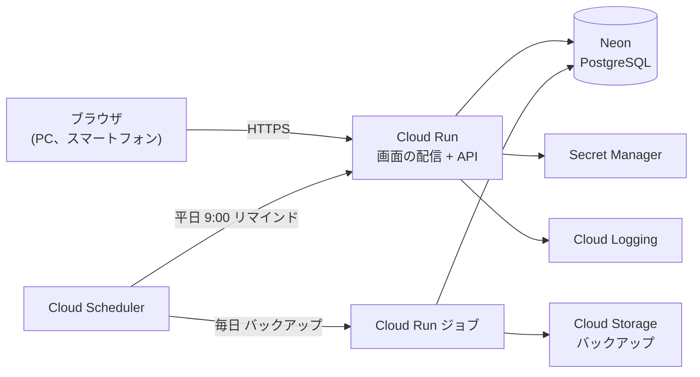

# 営業日報システム 技術選定書

> 更新日: 2026-11-07 / 状態: 初版
> 前提: 開発言語の指定なし、運用先は Google Cloud(データベースのみ Neon)、画面とAPIは分ける構成、運用費用をできるだけ抑える

## 1. 選定の方針

- **言語を1つにそろえる:** 画面とAPIを同じ言語で書き、入力チェックや列挙値の定義を共有する。API仕様書と実装のずれを防ぐ
- **運用の手間を減らす:** 利用者は50人以下なので、サーバーの管理が不要なマネージドサービスを使う
- **費用をできるだけ無料の範囲に収める:** アクセスがない間は停止するサービスと、無料プランのあるサービスを選ぶ
- **実績のある技術を選ぶ:** 情報が多く、長く保守されている技術を優先する

## 2. 全体構成



- 画面(ビルド済みの静的ファイル)とAPIを、1つの Cloud Run サービスから配信する。画面とAPIが同じドメインになるため、Cookie認証とCSRF対策が単純になる
- データベースは Neon の無料プランを使う。Neon は Google Cloud の外のサービス(AWS上で稼働)。データを海外(シンガポール)の Google Cloud 以外のサービスに保存することは確認済み
- ソースコードは画面とAPIで分け、1つのリポジトリで管理する(モノレポ)

## 3. 採用技術

### 3.1 言語・共通

| 項目                 | 採用                         | 理由                                                                       |
| -------------------- | ---------------------------- | -------------------------------------------------------------------------- |
| 言語                 | TypeScript                   | 画面とAPIを同じ言語で書ける。型で設計書の項目名や列挙値のずれを検出できる  |
| 実行環境             | Node.js(採用時点の最新LTS版) |                                                                            |
| パッケージ管理       | pnpm(ワークスペース機能)     | 画面、API、共有コードを1つのリポジトリで管理できる                         |
| 入力チェック         | Zod                          | 同じ定義を画面とAPIの両方で使える。API仕様書の入力チェックをここに集約する |
| コード整形、静的解析 | Biome                        | 整形と静的解析を1つのツールで行える                                        |

### 3.2 画面(フロントエンド)

| 項目                    | 採用                  | 理由                                                               |
| ----------------------- | --------------------- | ------------------------------------------------------------------ |
| UIライブラリ            | React                 | 利用者と情報が最も多い                                             |
| ビルドツール            | Vite                  | 設定が少なく、開発時の表示が速い                                   |
| 画面遷移                | React Router          |                                                                    |
| APIの呼び出しと状態管理 | TanStack Query        | 一覧の再取得やキャッシュを任せられる                               |
| フォーム                | React Hook Form + Zod | 日報入力のような行の追加、削除がある画面を扱いやすい               |
| スタイル                | Tailwind CSS          | スマートフォン対応のレイアウトを作りやすい                         |
| 部品                    | shadcn/ui             | ダイアログや選択欄など、キーボード操作に対応した部品をそろえられる |

### 3.3 API(バックエンド)

| 項目                   | 採用                     | 理由                                                                                                                                 |
| ---------------------- | ------------------------ | ------------------------------------------------------------------------------------------------------------------------------------ |
| フレームワーク         | Hono                     | 軽量で起動が速く、Cloud Run と相性がよい。Zod と組み合わせて入力チェックとAPI仕様の生成ができる                                      |
| ビルド                 | esbuild                  | API と共有パッケージを1つのファイルにまとめる(`apps/api/build.mjs`)。共有パッケージは TypeScript のソースのまま公開しているため、まとめてから実行する。ネイティブモジュールの `@node-rs/argon2` だけは、実行時に node_modules から読み込む |
| 開発サーバー           | tsx                      | TypeScript をそのまま実行し、ファイルの変更で再起動する                                                                              |
| データベース操作       | Prisma                   | ER図をスキーマとして定義でき、マイグレーションも管理できる。アプリは Neon の接続プール用のURL、マイグレーションは直接接続のURLを使う |
| パスワードのハッシュ化 | Argon2(`@node-rs/argon2`、argon2id) | 現在推奨されているハッシュ方式                                                                                                       |
| セッション             | データベースに保存       | Cloud Run はサーバーが入れ替わるため、メモリではなくデータベースに保存する                                                           |
| 祝日の判定             | `@holiday-jp/holiday_jp` | 日本の祝日データを持つライブラリ。リマインドの休日判定に使う                                                                         |

### 3.4 データベース(Neon)

| 項目         | 内容                                                                                                      |
| ------------ | --------------------------------------------------------------------------------------------------------- |
| サービス     | Neon(PostgreSQL)の無料プラン                                                                              |
| リージョン   | シンガポール(AWS ap-southeast-1)。Neon に東京リージョンがないため、日本に最も近いリージョンを選ぶ         |
| 無料の範囲   | 1プロジェクトあたり、容量1GB、計算時間は月100CU時間、データ転送は月5GB                                    |
| 計算サイズ   | 最小(0.25CU)に固定する。営業時間中だけ稼働すれば、月の稼働時間は無料の範囲(0.25CUで400時間)に収まる見込み |
| 自動停止     | 一定時間アクセスがないと停止し、次のアクセスで起動する。そのため、停止後の最初の表示が少し遅くなる        |
| 容量の見込み | 5年分(日報約6万件)で数百MB程度。運用中は容量を監視し、800MBを超えたら有料プランへの切り替えを検討する     |

- 無料プランには稼働の保証(SLA)がなく、条件が変わる可能性がある。問題が出た場合は Neon の有料プランか Cloud SQL に切り替える。どちらも PostgreSQL なので、コードの変更はほぼ不要

### 3.5 Google Cloud

| 項目               | 採用                          | 用途                                                                                            |
| ------------------ | ----------------------------- | ----------------------------------------------------------------------------------------------- |
| リージョン         | シンガポール(asia-southeast1) | データベースと同じ地域に置き、1回の画面表示で何度も発生するデータベースへの問い合わせを速くする |
| アプリの実行       | Cloud Run                     | 画面とAPIの配信。アクセスがない間は停止し、費用がかからない                                     |
| バックアップの実行 | Cloud Run ジョブ              | 毎日、データベースの全データを書き出して Cloud Storage に保存する                               |
| バックアップの保管 | Cloud Storage                 | 書き出したデータを保管する。保持期間を過ぎたものは自動で削除する                                |
| 定期処理           | Cloud Scheduler               | 平日9時のリマインドと、毎日のバックアップを呼び出す                                             |
| 秘密情報           | Secret Manager                | データベースの接続文字列など                                                                    |
| ログ               | Cloud Logging                 | APIのログを構造化して出力する                                                                   |
| コンテナの保管     | Artifact Registry             |                                                                                                 |

### 3.6 テスト・開発

| 項目                  | 採用           | 用途                                                                                                                   |
| --------------------- | -------------- | ---------------------------------------------------------------------------------------------------------------------- |
| 単体テスト、APIテスト | Vitest         | テスト仕様書の4章。テスト用のPostgreSQLに対して実行する                                                                |
| 画面テスト(E2E)       | Playwright     | テスト仕様書の5章。PCとスマートフォンの画面サイズで実行できる                                                          |
| ローカル開発          | Docker Compose | PostgreSQLをローカルで動かす。Docker がない場合は Prisma のローカル用データベース(`prisma dev`)で代用できる |
| CI/CD                 | GitHub Actions | テストを実行し、成功したらステージングにデプロイする。本番へは、ステージングで確認したものを手動実行のワークフローでデプロイする(手順は cicd.md) |

### 3.7 環境

| 環境               | 用途                                                                                                    |
| ------------------ | ------------------------------------------------------------------------------------------------------- |
| ローカル           | 開発、APIテスト、画面テスト。Docker Compose の PostgreSQL を使う                                        |
| CI(GitHub Actions) | プッシュごとにAPIテストと画面テストを実行する。テスト用のPostgreSQLはCIの中で起動する                   |
| ステージング       | Cloud Run のステージング用サービスと、Neon のステージング用プロジェクト(無料)。テストデータのみを入れる |
| 本番               | Cloud Run の本番用サービスと、Neon の本番用プロジェクト                                                 |

**ステージング**

- 本番へ出す前の画面テスト、性能テスト、バックアップの復元テストに使う
- Neon はプロジェクトごとに無料の計算時間があるため、本番とは別のプロジェクトにして、本番の無料枠を減らさない
- Cloud Run は使わない間は停止するため、無料枠の範囲に収まる見込み
- 定期処理(リマインド、バックアップ)は Cloud Scheduler に設定せず、確認するときに手動で実行する。Cloud Scheduler の無料枠のジョブ数を本番で使うため
- 実データは入れない。本番のデータをコピーしない

**本番へのデプロイ**

- ステージングで確認した後、本番には新しいバージョンをトラフィックを流さない状態でデプロイし、専用のURLで表示を確認してから切り替える(Cloud Run のタグ付きリビジョン)。問題があれば前のバージョンにすぐ戻せる
- 確認用のURLは本番のデータベースにつながるため、確認では実データを変更しない。データベースの構造を変える変更は、古いバージョンでも動く形で先に適用する
- 実データでの構造変更の確認が必要な場合は、本番のデータベースから Neon のブランチを一時的に作って確認し、確認後に削除する。ブランチは本番と計算時間を共有し、実データを含むため常設しない

## 4. リポジトリ構成

```text
nippo/
├── apps/
│   ├── web/        画面(React)
│   └── api/        API(Hono)。本番ではビルドした画面も配信する
├── packages/
│   └── shared/     画面とAPIで共有する Zod の定義、列挙値、型
├── docs/           設計書
└── CLAUDE.md
```

## 5. 検討した他の候補

| 候補                           | 採用しなかった理由                                                                             |
| ------------------------------ | ---------------------------------------------------------------------------------------------- |
| Next.js(画面とAPIを一体で作る) | 画面とAPIを分ける方針のため。分けて作ることもできるが、機能の多くを使わない                    |
| Python(FastAPI)+ React         | 画面とAPIで言語が分かれ、入力チェックの定義を共有できない                                      |
| Cloud SQL for PostgreSQL       | 無料プランがなく、最小構成でも月額費用がかかる                                                 |
| SQLite + Litestream            | 1台のサーバーで書き込む前提のため、デプロイ中に新旧のサーバーが同時に動く Cloud Run と合わない |
| Supabase                       | 無料プランの容量(500MB)が5年分に足りない可能性があり、7日間アクセスがないと停止する            |
| Firestore                      | 日報の検索や作業時間の集計など、結合や集計の多い処理には関係データベースが向いている           |
| App Engine                     | Cloud Run の方が構成の自由度が高く、Google Cloud でも新規の利用はこちらが中心                  |

## 6. 設計書への影響

| 影響         | 内容                                                                            |
| ------------ | ------------------------------------------------------------------------------- |
| ER図         | セッションをデータベースに保存するため、`sessions` テーブルを追加した(反映済み) |
| テスト仕様書 | 性能テストとバックアップの復元テストを、ステージングで行う(反映済み)            |

## 7. 技術選定で決定した事項

| No  | 事項                   | 決定内容                                                                           |
| --- | ---------------------- | ---------------------------------------------------------------------------------- |
| 1   | ソースコードの管理場所 | GitHub                                                                             |
| 2   | バックアップの保持期間 | 7日。Cloud Storage のライフサイクル設定で、7日を過ぎたバックアップを自動で削除する |
| 3   | データの保管先         | 海外(シンガポール)の Neon に保存してよい                                           |
